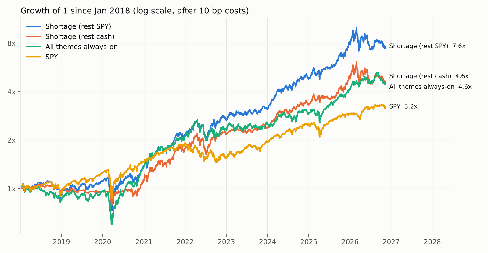
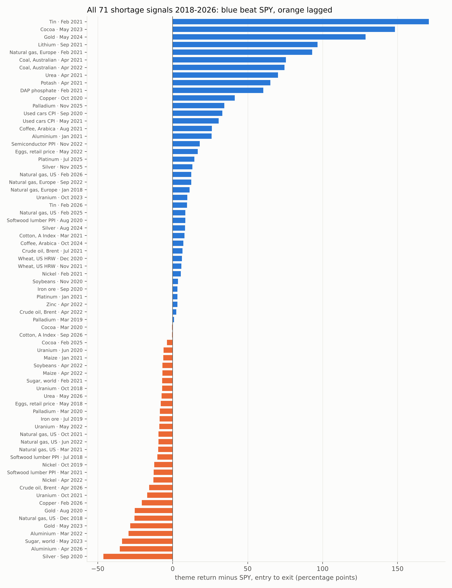
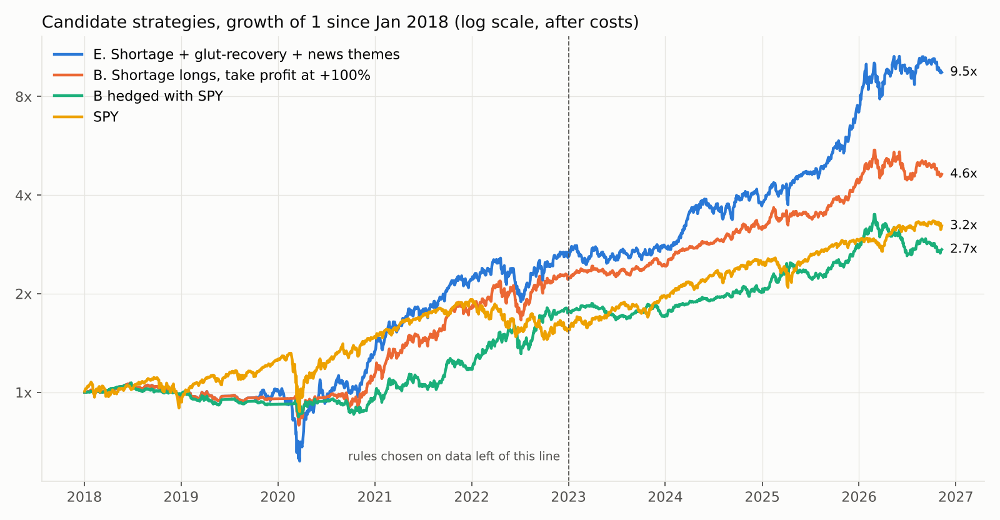
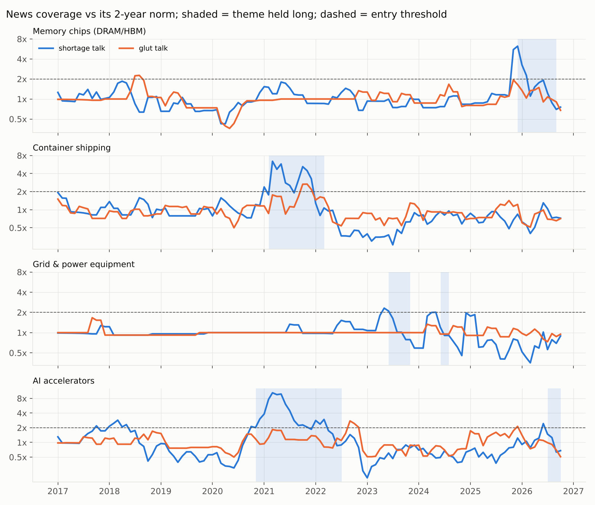
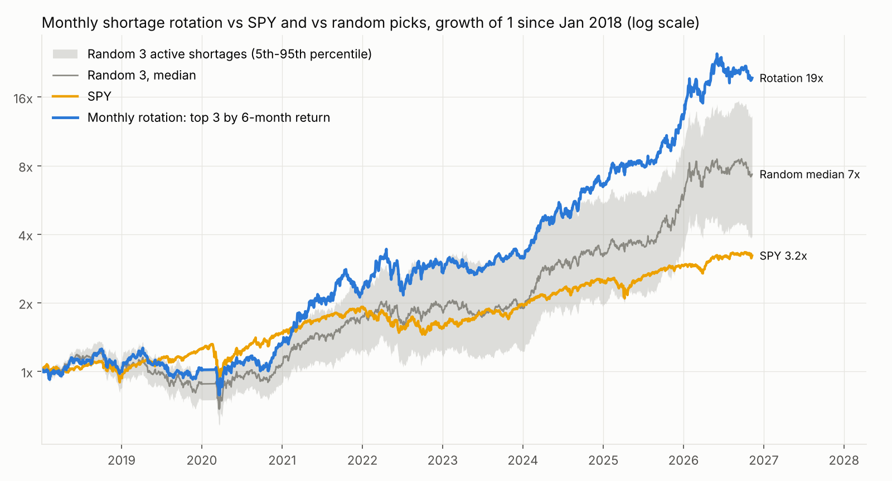

# ShortageSeeking

A rule-based strategy that looks for the most statistically unusual **physical shortages**, and goes long
the listed producers of whatever is scarce. Back-tested from January 2018 to November 2026 using only
information that was published before each trade.

**Headline:** 71 shortage signals since 2018. The portfolio returned 19.0% a year (Sharpe 0.99) while being
invested only 56% of the time, against 14.2% (Sharpe 0.79) for SPY. The edge is real but lumpy: ten trades
produced about three quarters of the total gain, and only 56% of signals made money.



## The idea

A shortage shows up in one place before it shows up in producers' earnings: the price of the scarce
good. So each "item" is one good, tracked by **one external price series**, mapped to **one tradable theme**.

| Shortage tracked by | Theme bought |
|---|---|
| Brent, US gas, Europe gas, Australian coal | E&Ps, US gas producers, LNG/Equinor, coal miners |
| Copper, aluminium, iron ore, nickel, zinc, tin | the respective miners / smelters |
| Gold, silver, platinum, palladium | GDX, SIL, PGM miners |
| Uranium, lithium (IMF) | URA, lithium producers |
| Urea, DAP, potash | fertiliser producers |
| Wheat, maize, soybeans | agribusiness (MOO) |
| Softwood lumber PPI, used-car CPI, egg retail price, semiconductor PPI (BLS) | timber, auto dealers, Cal-Maine, SMH |
| Cocoa, coffee, sugar, cotton | front futures (no natural listed producer) |

30 items, 25 themes; the full mapping is in `shortage/config.py`.

## The rules (fixed before the first backtest run)

For each item, every month, using only data up to that month:

1. **Unusual move:** the 6-month log price change is at least **1.5 standard deviations** above that item's
   own trailing 10-year history of 6-month changes (minimum 5 years of history).
2. **Breakout:** the price is at a new **24-month high**.
3. Both true → shortage is ON. Buy the theme, equal-weight across its tickers.
4. **Exit** when the price falls below its own 6-month average, or after 24 months.

Portfolio: equal weight across active themes, 20% cap per theme, the rest in T-bills (or SPY in the
overlay variant). 10 bp cost per side.

### Look-ahead discipline

- The z-score for month *t* excludes month *t* from its own mean and standard deviation.
- Trades happen at the close of a fixed trading day in the **following** month, after the data is public:
  day 5 for the World Bank Pink Sheet, day 15 for IMF and BLS series, day 1 for real-time futures.
- A ticker joins its theme basket only from the day it has a price; nothing is bought before it listed.
- If a data feed stops updating, the position is closed. No data means no position.
- Parameters were not tuned. The 27-combination grid below is reported in full rather than used to pick.

## Results, January 2018 to November 2026

| | CAGR | Vol | Sharpe | Max drawdown | Avg invested |
|---|---|---|---|---|---|
| Shortage, rest in cash | 19.0% | 19.4% | 0.99 | -28.7% | 56% |
| Shortage, rest in SPY | 25.9% | 24.0% | 1.08 | -37.9% | 100% |
| SPY | 14.2% | 19.0% | 0.79 | -33.7% | 100% |
| ACWI | 11.1% | 18.0% | 0.67 | -33.5% | 100% |
| All 25 themes held permanently | 18.7% | 20.7% | 0.93 | -42.8% | 100% |

Per signal (71 events, average holding period about 6.5 months):

| | Value |
|---|---|
| Made money | 56% |
| Beat SPY over the holding period | 56% |
| Mean theme return / median | +20.0% / +8.8% |
| Mean return above SPY | +13.1 points |
| Mean 6-month forward return vs random entry into the same theme | 16.9% vs 10.9% (94th percentile) |
| Same at 3 months / 12 months | 74th / 91st percentile |



### Where it was early

| Shortage | Bought | Signal strength (z) | Price still to rise to peak | Theme return | vs SPY |
|---|---|---|---|---|---|
| Used cars | Sep 2020 | 2.3 | +3% | +51% | +33 |
| Copper | Oct 2020 | 2.2 | +52% | +75% | +41 |
| Europe gas | Feb 2021 | 4.3 | +423% | +103% | +93 |
| Tin | Feb 2021 | 1.6 | +101% | +180% | +171 |
| Fertiliser (DAP, urea, potash) | Feb to Apr 2021 | 1.7 to 2.1 | +126% to +275% | +63% to +74% | +60 to +70 |
| Thermal coal | Apr 2021 | 2.8 | +137% | +91% | +75 |
| Lithium | Sep 2021 | 1.7 | +371% | +83% | +97 |
| Cocoa | May 2023 | 1.7 | +238% | +176% | +148 |
| Gold | May 2024 | 2.1 | +115% | +174% | +129 |

The Europe gas signal fired in February 2021, about seven months before the energy crisis made headlines.

### Where it failed

- **Short whipsaws.** The 16 trades that lasted 45 trading days or less averaged -5 points against SPY;
  the longer ones averaged +18. Losses are small and frequent, wins are large and rare.
- **Price spike without producer leverage.** Silver 2020 (-46 vs SPY), gold 2020 and 2023, aluminium 2022
  and 2026, US gas (six signals, four losers). Miners' costs rose with the metal, or the spike was weather.
- **Late-cycle signals.** Spring 2022 (nickel squeeze, zinc, aluminium, grains after the invasion) fired
  near the top.
- **Regime dependence.** Entries from 2018 to 2021 averaged +15.8 points over SPY; entries from 2022 to
  2026 averaged +9.7 with a negative median. 2026 to date is -3% against +11% for SPY.
- **Theme beta explains much of it.** Simply holding all 25 themes permanently returned 18.7% a year.
  The signal's contribution is similar return with roughly half the exposure and a shallower drawdown.

### Sensitivity

All 27 combinations of lookback (3, 6, 12 months), entry threshold (1.0, 1.5, 2.0) and exit average
(3, 6, 10 months) are in `outputs/sensitivity.csv`. Sharpe ranges from 0.90 to 1.26 (median 1.01) and
CAGR from 14.5% to 26.6%; none is worse than SPY on Sharpe. The pre-set base case sits in the middle.

### Hypotheses for the next out-of-sample test (not adopted)

These splits were found after the fact, so they are ideas to test going forward, not results:

| Condition at entry | Signals | Made money | Mean vs SPY |
|---|---|---|---|
| z ≥ 2 | 24 | 67% | +19.9 |
| z < 2 | 47 | 51% | +9.7 |
| 4 or more items in shortage at once | 48 | 63% | +15.7 |
| Fewer than 4 | 23 | 43% | +7.8 |
| Theme already above its 200-day average | 66 | 59% | +14.6 |
| Theme below its 200-day average | 5 | 20% | -6.7 |

## Live readings (data through October 2026)

- **ON:** copper (bought February 2026; COPX is -11% since, 21 points behind SPY, and still held because
  copper remains above its 6-month average).
- **Close to triggering:** sugar (z 2.0) and cocoa (z 1.9) pass the unusual-move test but are not at
  24-month highs. Europe gas is at a 24-month high and up 85% in six months but scores only z 1.0.
- **Just exited (November 2026):** tin, cotton.
- Everything else is off. Precious metals, aluminium and urea are in sharp declines.

Full table: `outputs/live_signals.csv`.

## Version 2: news, gluts, the futures curve, and trade management

Everything in this section was run with one extra safeguard: any rule choice was made on trades entered
**before 2023** and then judged on trades entered **from 2023 on**. Code is in `shortage/v2.py`, `run2.py`;
tables are in `outputs/v2/`.



### What was added

| Addition | How it is measured | Source |
|---|---|---|
| News narrative | Monthly count of posts mentioning an industry word with "shortage", and separately with "glut", against that industry's own prior 2-year rate | Hacker News full-text search, 20 industries, 2015 onward |
| News-only themes | Memory chips (DRAM/HBM), AI accelerators, grid and power equipment, container shipping: no free price series exists, so the news count is the signal | same |
| Oversupply | Exact mirror of the shortage rule: a 6-month fall 1.5 standard deviations beyond history, at a 24-month low | same price data as v1 |
| Futures curve | Cash price against 3-month price, and warehouse stocks, for five LME metals; front-month fund against 12-month fund for oil and US gas | LME settlements (Westmetall), fund prices |
| Commodity expression | Roll-inclusive commodity funds (USO, UNG, CPER, DBB, WEAT, CORN, SOYB, CANE, GLD, SLV, PPLT, PALL), so contango cost is in the return | Yahoo |
| Trade management | Trailing stops (15%, 25%), profit targets (+50%, +100%), re-entry on a new high after a stop | simulated daily |

### Findings

**1. Shorting gluts does not work; buying when a glut ends might.**

| | Trades | Won | Mean return | Mean vs SPY |
|---|---|---|---|---|
| Shortage: long the producers | 71 | 56% | +19.8% | +12.9 |
| Oversupply: short the producers | 27 | 41% | -6.8% | +5.8 |
| Glut ends (price back above 6-month average): long producers for 12 months | 27 | 67% | +29.1% | +8.6 |

The short basket lost 2.6% a year with a 56% drawdown. The mirror rule fires near the bottom (April 2020:
oil, platinum, zinc, Europe gas) and producers then rebound. A shortage-versus-oversupply long-short basket
(Sharpe 0.65) was worse than shortage longs alone (0.96). Buying at the end of a glut was strong before
2023 (+22 points over SPY) but lagged SPY by 4 points afterwards, so it is not confirmed.

**2. The best shortage trades are the ones the news has not noticed yet.**

| Price-based shortage signal, news state at entry | Trades | Won | Mean return |
|---|---|---|---|
| Shortage coverage below 2x normal | 38 | 61% | +20.1% |
| Shortage coverage already 2x normal or more | 11 | 36% | +10.9% |
| News net balance disagrees with the price | 20 | 70% | +19.8% |
| News net balance agrees | 29 | 45% | +16.8% |

As a holding rule, "stay in after the price exit while shortage talk is still above normal" raised the mean
trade from +18.1% to +31.8% before 2023, but only from +17.9% to +19.2% on the nine trades after, and at
portfolio level it did not beat the simpler rule. "Leave when glut talk overtakes" clearly hurt.

**3. News alone found the memory, shipping and power-equipment shortages, on very few trades.**

| News-only long | Entry | Exit | Basket return |
|---|---|---|---|
| Container shipping | Feb 2021 | Mar 2022 | +184% |
| Memory chips (DRAM/HBM) | Dec 2025 | Sep 2026 | +346% |
| Grid and power equipment | Jun 2023 | Nov 2023 | +23% |
| AI accelerators | Nov 2020 | Jul 2022 | +4% |
| Grid and power equipment | Jun 2024 | Aug 2024 | -10% |
| AI accelerators | Jul 2026 | Oct 2026 | +18% |

Six trades, five winners, median +21%. The mean (+94%) is two trades. News-only glut shorts (three trades)
were flat. This answers the HBM question from v1, but six trades prove nothing.



**4. Producers beat commodity funds; the curve sample is too small to rule on.**
On the 34 shortage signals where both exist, producers averaged +8.6% and the commodity fund +4.1%. For
the 16 shortage signals that began in backwardation, producers made +10.4% while the fund lost 7.0%, the
opposite of the textbook expectation. With 20 curve observations in total this is inconclusive. LME
stocks were already falling in 9 of 11 metal shortages, so stocks confirm but do not discriminate.

**5. Stops cost return; a profit target helps a little.**

| Shortage longs | CAGR | Sharpe | Max drawdown | Sharpe 2018-22 | Sharpe 2023-26 |
|---|---|---|---|---|---|
| A. Price exit only (v1) | 19.0% | 0.99 | -28.7% | 0.94 | 1.05 |
| B. A + take profit at +100% | 18.9% | 1.09 | -25.7% | 0.97 | 1.28 |
| C. A + 15% trailing stop | 14.6% | 1.12 | -21.0% | 0.86 | 1.62 |
| D. A + glut-recovery longs | 24.9% | 1.04 | -42.3% | 0.93 | 1.19 |
| E. D + news-only shortage themes | 29.0% | 1.16 | -42.3% | 0.92 | 1.45 |
| B hedged with SPY | 12.0% | 0.84 | -25.3% | 0.82 | 0.86 |
| SPY | 14.2% | 0.79 | -33.7% | 0.52 | 1.33 |

- **B was the pick on pre-2023 data** (highest Sharpe there) and it held up afterwards.
- Stops made things worse before 2023 and better after; that is not a stable result. Re-entry after a stop
  never helped. A +50% target cut too many winners.
- In 2023-26 none of A to D beat SPY's Sharpe of 1.33. Only E did, and E's edge is the memory trade.
- Hedged with SPY, the shortage basket earned about 12% a year at Sharpe 0.8 in both periods with a
  correlation of -0.1 to SPY. That is its most consistent use: a diversifier, not a replacement.

### The strategy that survives

1. **Enter** on the v1 price rule. Skip nothing on news grounds, but size up when coverage is still quiet.
2. **Express** through producers, not commodity funds.
3. **Exit** when the price falls below its 6-month average, or take profit at +100%. No trailing stop.
4. **Re-enter** only on a fresh price signal.
5. **Do not short gluts.** Put a theme on the watchlist when its glut ends.
6. **Add news-only themes** (memory, power equipment, shipping, AI chips) at small size: enter when
   shortage mentions reach 2x their 2-year norm with at least five mentions, exit when back below normal.
7. **Hedge with SPY** if the goal is an uncorrelated return rather than beating the index.

### Live readings, v2

- Copper is the only price-based shortage on. No oversupply signal is on.
- All four news-only themes are below their norms. Memory exited in September 2026 after coverage faded.
- Cocoa's glut ended in June 2026, so it is the one open glut-recovery long (+33% since).

### Additional limitations in v2

- **The news source is one technology forum.** GDELT, the broad news archive I intended to use, refused
  requests from this environment (the loader is in `shortage/sentiment.py`). Hacker News counts are small
  (often under ten mentions a month), English-only and tech-biased; farm goods and metals are thin.
- **I did not "read" the industries.** A model reading old articles today knows how each story ended, so
  only counted, time-stamped mentions are used.
- **The curve for grains, softs, coal, uranium and lithium is not measured.** There is no free history of
  individual contract months.
- **Short-side costs are a flat 1% a year;** real borrow on small miners can be far higher.
- The 2023-26 judging period has 19 price-based shortage trades. It is a check, not proof.

## Version 3: earnings calls, analyst reports, bottlenecks, and the full theme list

**The full list of 49 themes, with status, bottleneck and assets, is in [THEMES.md](THEMES.md).**

### Sources used

| Source | What it is | Coverage |
|---|---|---|
| Earnings calls | 33,362 S&P 500 call transcripts (open MIT-licensed dataset `kurry/sp500_earnings_transcripts`); only scores are stored here | 2005 to May 2025 |
| SEC quarterly reports | 10-Q / 10-K of 112 companies across every theme, risk-factor boilerplate filtered out | Nov 2024 to Nov 2026 (900 filings) |
| Fed Beige Book | 78 reports, the "analytical report" with a clean release date | 2017 to Oct 2026 |
| Analyst and trade reports | Web search on 10 Nov 2026; used only for today's status, never in a backtest | current |

### How a bottleneck is detected

Every company is treated as a sensor. Each sentence is checked for shortage language ("constrained",
"sold out", "on allocation", "lead times extended"...) or glut language ("oversupply", "excess inventory",
"destocking", "pricing pressure"...), and for which of 38 named inputs it is about (HBM, transformers,
copper, labour...). An input becomes a live bottleneck when at least five companies cite it in the same
three months and that is at least twice its own two-year norm. The trade is to buy the companies that
*sell* the constrained input. Mapping is in `shortage/bottleneck.py`.

### Backtest of the call-based signal (entries 2018 to May 2025)

| | Trades | Won | Mean return | Mean vs SPY |
|---|---|---|---|---|
| Bottleneck: long the suppliers | 14 | 57% | +16.6% | +11.6 |
| of which entered 2018-22 | 12 | 50% | +12.0% | +8.0 |
| of which entered 2023-25 | 2 | 100% | +44.1% | +33.4 |
| Glut: short the suppliers | 8 | 25% | -18.0% | -7.0 |

- Hits: container shipping (Apr 2021, +57%), lumber (Nov 2020, +52%), electric power for data centres
  (Aug 2024, +72%), skilled labour via contractors (May 2021, +31%), auto chips (Feb 2021, +22%).
- Misses: housing 2018, gas 2018 and 2022, chip equipment Nov 2021 (-29%).
- As a portfolio it was invested rarely: 8.2% a year, Sharpe 0.64; hedged with SPY, Sharpe 0.80.
- Shorting gluts lost again, for the third time across three independent data sources.
- **The detector is conservative.** It never fired on memory or transformers before the call data ends in
  May 2025, because fewer than five S&P 500 companies named them in one quarter.
- Fourteen trades is a small sample. Treat this as a third, independent confirmation of the long side, not
  as a stand-alone strategy.

### Which asset inside a theme

Tested on the same 14 signals, choosing at entry with no hindsight:

| Choice | Won | Mean return |
|---|---|---|
| Equal-weight basket of suppliers | 57% | +16.6% |
| The 6-month price leader | 57% | +15.9% |
| The 6-month price laggard | 86% | +13.7% |
| The designated pure play | 71% | +16.1% |

No selection rule beat the plain basket, so **the best asset is the equal-weight basket of the companies
that sell the bottleneck**. THEMES.md lists each basket with the purest name first.

### The Beige Book as a whole-economy gauge

Shortage minus glut sentences per report: +37 in 2021, +26 in 2022, +5 in 2023, and about -1.5 in each of
2024, 2025 and 2026. Outside AI hardware, the US economy is not short of things today; the only input
cited repeatedly in October 2026 is skilled labour.

### What the list says today

- **Analysts call 12 themes short:** memory, optical lasers, AI accelerators, advanced packaging, gas
  turbines, transformers, grid power, aero engines, aircraft, rare earths, critical minerals, uranium.
  Nearly all are one chain: AI data centres and the power to run them.
- **11 of those 12 supplier baskets are below their 200-day average** (memory -18%, optical -31%,
  packaging -23%, transformers -17%, uranium -30%). In v1, themes bought below that average lost money,
  and in v2, signals with heavy coverage did worse than quiet ones. The shortages are real but crowded
  and currently selling off.
- **Stale reports are a trap.** Early-2026 reports called an oil and LNG glut. Since then Brent has gone
  from $85 to $125 and European gas is up 85% in six months. Dated prices beat dated opinions.
- **Model signals on:** copper only (price rule). Companies citing shortages most in current filings:
  skilled labour (11), natural gas (4), memory (3).

### Limitations of v3

- Call transcripts stop in May 2025; after that only formal filings are scored, which use less candid
  language and gave too few hits to trade on.
- The word lists and the input-to-supplier mapping were written in 2026.
- The "analysts say" column is a one-day web search of mixed-quality sources and is not back-tested.
- Free call-transcript websites opt out of automated collection, so they were not used.

### Sources for the analyst column

[Apollo: the growing compute shortage](https://www.apollo.com/content/dam/apolloaem/documents/insights/the-growing-compute-shortage.pdf) ·
[Transformers Magazine: power bottleneck](https://transformers-magazine.com/tm-news/power-bottleneck-slows-ai-data-centres/) ·
[HBM shortages and data-centre plans](https://news.pcim.mesago.com/hbm-chip-shortages-put-data-center-growth-plans-at-risk-a-66da023f5156bb2384c9c249f2fdcaad/) ·
[DRAM record, NAND flat, Oct 2026](https://tech-insider.org/dram-record-high-nand-flat-21-months-october-2026/) ·
[TrendForce: InP shortage](https://trendforce.com/news/2026/08/06/news-inp-shortage-emerges-as-ai-optical-interconnect-bottleneck/) ·
[S&P Global: copper concentrate](https://www.spglobal.com/energy/en/news-research/latest-news/metals/062426-concentrate-supply-remains-tightest-segment-of-copper-value-chain-nornickel) ·
[Goldman 2026 commodity outlook](https://investinglive.com/commodities/goldman-sachs-2026-outlook-buy-gold-to-4900-sell-oil-to-50-20251230) ·
[TD Economics commodities](https://economics.td.com/domains/economics.td.com/documents/reports/me/Commodities_Quick_Take_Nov2025.pdf) ·
[LNG supply glut](https://www.rigzone.com/news/wire/lng_market_faces_looming_supply_glut-09-sep-2025-181739-article/) ·
[BNEF commodities 2026](https://about.bnef.com/insights/commodities/commodities-in-2026-10-numbers-to-watch-from-power-to-oil/) ·
[S&P Global: rare earth bottlenecks](https://www.spglobal.com/market-intelligence/en/news-insights/articles/2026/1/rare-earth-supply-bottlenecks-set-to-persist-in-2026-97422193) ·
[BCG: aerospace castings and forgings](https://www.bcg.com/publications/2024/fixing-aerospaces-supply-chain-for-casting-and-forging) ·
[Aviation Week: engine repair slots](https://aviationweek.com/mro/aircraft-propulsion/demand-soaring-commercial-engine-maintenance-repair-slots) ·
[Uranium outlook commentary](https://skillings.net/uranium-market-outlook-2026-smr-demand-and-supply-gaps/) ·
[Coffee and cocoa supplies](https://www.rfdtv.com/coffee-cocoa-prices-slide-as-global-supplies-expand?p=100) ·
[PV oversupply](https://www.pv-magazine.com/2026/08/28/global-pv-additions-forecast-to-reach-638-gw-in-2026/) ·
[Xeneta container outlook](https://www.seatrade-maritime.com/containers/supply-chain-damage-already-done-says-xeneta)

## Version 4: rotation, moving-average filters, "still accelerating"

`python run4.py` writes `outputs/v4/`. Price-based shortage signals, producers, Jan 2018 to Nov 2026.

| Rule | CAGR | Sharpe | Max drawdown | Sharpe 2018-22 | Sharpe 2023-26 |
|---|---|---|---|---|---|
| Base: hold every active shortage (20% cap each) | 18.0% | 0.95 | -29% | 0.91 | 1.00 |
| Hold only while still accelerating (z at least 0.5) | 19.8% | 1.03 | -29% | 0.93 | 1.16 |
| Rotate quarterly into the 3 strongest shortages | 26.3% | 1.11 | -38% | 1.32 | 0.99 |
| Rotate monthly into the 3 strongest shortages | 27.5% | 1.07 | -40% | 1.08 | 1.08 |
| Rotate monthly into the single strongest | 27.1% | 0.77 | -68% | 0.52 | 1.08 |
| Hold only while theme is above its 100-day average (checked daily) | 12.1% | 0.77 | -30% | 0.64 | 0.94 |
| Hold only while theme is above its 200-day average (checked daily) | 14.9% | 0.84 | -29% | 0.76 | 0.94 |
| SPY | 14.2% | 0.79 | -34% | 0.52 | 1.33 |

- Rotation into the top 3 raises return mainly by concentrating (33% a theme instead of 20%); Sharpe improves a little, drawdown gets worse.
- A daily moving-average switch whipsaws and costs 3 to 6 points a year.
- As a one-time check on the entry day it helps: 64 trades entered above the 100-day average won 59% (mean +22%); the 7 entered below won 29% (mean +0.5%).

## Version 5: combined universe (price + news + earnings-call bottlenecks) and overlays

`python run5.py` writes `outputs/v5/`. News and call-based bottleneck signals are full members here
(news rule applied to all 20 forum topics; call bottleneck needs 3 firms at twice the norm).

| Rule | CAGR | Sharpe | Max DD | CAGR 2018-22 | Sharpe 2018-22 | CAGR 2023-26 | Sharpe 2023-26 |
|---|---|---|---|---|---|---|---|
| Price signals only (old base) | 19.0% | 0.99 | -29% | 16.9% | 0.94 | 21.8% | 1.05 |
| Combined, hold all active (20% cap) | 22.0% | 1.00 | -39% | 12.8% | 0.66 | 35.1% | 1.42 |
| Combined + 50-day in/out | 12.7% | 0.77 | -28% | 4.8% | 0.37 | 23.9% | 1.25 |
| Combined + 100-day in/out | 17.1% | 0.94 | -31% | 7.5% | 0.51 | 30.8% | 1.42 |
| Combined + 100-day entry gate | 22.8% | 1.06 | -28% | 15.4% | 0.80 | 33.2% | 1.36 |
| Combined, 33% cap, no selection | 25.0% | 0.98 | -51% | 11.7% | 0.57 | 44.7% | 1.45 |
| Combined, rotate quarterly, top 3 by 6-month momentum | 30.4% | 1.07 | -46% | 21.7% | 0.83 | 42.8% | 1.35 |
| Combined, rotate monthly, top 3 by 6-month momentum | 39.9% | 1.26 | -38% | 22.5% | 0.84 | 66.4% | 1.76 |
| 100-day gate + rotate quarterly top 3 | 32.8% | 1.16 | -38% | 25.6% | 0.99 | 42.8% | 1.35 |
| 100-day gate + rotate quarterly top 5 | 25.3% | 1.12 | -34% | 22.9% | 1.02 | 28.4% | 1.26 |
| Random 3 active shortages (mean of 300 runs) | 22.2% | 0.88 | -47% | 13.2% | 0.61 | 35.1% | 1.22 |
| SPY | 14.2% | 0.79 | -34% | 9.3% | 0.52 | 20.8% | 1.33 |

- Momentum top-3 beats 90% of random top-3 portfolios on Sharpe over the full period, 71% after 2023.
- By source, held alone: price 19.0% (Sharpe 0.99), news 16.7% (1.07), calls 8.2% (0.61).
- The 50-day in/out rule trades about 13 times a year and loses roughly 9 points of annual return.

## Version 6: the monthly top-3 rotation in detail

`python run6.py` writes `outputs/v6/` and [TRADES.md](TRADES.md) (all 90 trades).

**Rule:** every 21 trading days, from all shortages currently active (price, news or earnings-call signal),
hold the three whose producer baskets have the highest 6-month return, one third each. A holding whose
shortage ends is sold at once. Idle money sits in T-bills. 10 bp cost per side.



| | CAGR | Vol | Sharpe | Max DD | Sharpe 2018-22 | Sharpe 2023-26 |
|---|---|---|---|---|---|---|
| Monthly rotation | 39.9% | 30.5% | 1.26 | -38% | 0.84 | 1.76 |
| 500 random monthly portfolios, median | 25.0% | 28.5% | 0.92 | -45% | 0.57 | 1.34 |
| ... 95th percentile | 33.8% | 29.3% | 1.17 | -39% | 0.92 | 1.64 |
| Rotation's rank among the 500 | 99.8% | | 99.2% | | 90% | 98% |
| SPY | 14.2% | 19.0% | 0.79 | -34% | 0.52 | 1.33 |

| Year | Rotation | SPY | Difference |
|---|---|---|---|
| 2018 | +1% | -5% | +6 |
| 2019 | +2% | +31% | -29 |
| 2020 | +28% | +18% | +10 |
| 2021 | +73% | +29% | +44 |
| 2022 | +21% | -18% | +39 |
| 2023 | +14% | +26% | -12 |
| 2024 | +106% | +25% | +81 |
| 2025 | +98% | +18% | +80 |
| 2026 to date | +52% | +11% | +40 |

90 trades, 61% won, 54% beat SPY, mean +14.5%, median +4.9%, average holding 67 trading days. The ten
best trades produced 78% of the total gain; the memory trade alone about a seventh.

### Additions tested (one change at a time)

| Change | CAGR | Sharpe | Max DD | Sharpe 2018-22 | Sharpe 2023-26 |
|---|---|---|---|---|---|
| Baseline | 39.9% | 1.26 | -38% | 0.84 | 1.76 |
| Weight by inverse volatility | 39.2% | 1.27 | -37% | 0.86 | 1.78 |
| 100-day entry gate | 40.6% | 1.29 | -37% | 0.92 | 1.74 |
| Rank by blend of 3/6/12-month return | 41.7% | 1.29 | -38% | 1.03 | 1.60 |
| Rank by 12-month return | 39.6% | 1.24 | -42% | 0.97 | 1.56 |
| Rank by 3-month return | 31.9% | 1.06 | -41% | 0.77 | 1.42 |
| To cash when SPY is below its 200-day average | 33.2% | 1.24 | -34% | 0.93 | 1.57 |
| Idle money in SPY | 40.0% | 1.20 | -53% | 0.75 | 1.80 |
| Only themes with positive 6-month return | 31.0% | 1.10 | -51% | 0.49 | 1.78 |
| Top 2 | 45.4% | 1.22 | -48% | 0.82 | 1.70 |
| Top 4 | 29.4% | 1.08 | -35% | 0.76 | 1.49 |
| Top 5 | 27.7% | 1.12 | -32% | 0.91 | 1.40 |
| Rebalance every 2 weeks | 32.9% | 1.09 | -50% | 0.75 | 1.49 |
| 20 bp cost instead of 10 | 39.0% | 1.23 | -38% | 0.81 | 1.75 |

Only inverse-volatility weighting improved both halves, and only marginally. The baseline is already close
to the best of this family; the differences among the top rows are within noise.

## Limitations (v1)

- **No memory-chip (DRAM/HBM) test.** I found no free, point-in-time DRAM contract price series. The
  semiconductor PPI is a weak stand-in (one signal, November 2022). Any monthly price CSV can be added as
  an item, so a DRAM or HBM contract series would slot straight in.
- **Stale feeds.** The uranium and lithium series end June 2025 and the four BLS series end January 2025
  (the mirror stopped updating). They are back-tested up to those dates and give no live reading.
- **Hindsight in theme choice.** The mapping is "obvious producers", but it was written in 2026. Some
  tickers that existed then are gone (for example PotlatchDeltic returned no data); coal names that
  merged are missing.
- **Volatility memory.** After an extreme episode the 10-year standard deviation stays inflated, which is
  why Europe gas up 85% scores only z 1.0 today. The detector is slow to re-arm after a blow-off.
- **Not modelled:** currency moves on the non-US tickers, futures roll yield on the four soft
  commodities (Yahoo's front-month series is unadjusted), small revisions to World Bank and PPI data.
- **One regime.** 2018 to 2026 contains one very large shortage cluster (2020 to 2022). 71 signals is a
  small sample and they are not independent of each other.

## Run it

```bash
pip install -r requirements.txt
python run.py            # v1, uses cached data in data/raw
python run.py --refresh  # re-download prices and commodity data
python charts.py
python -m shortage.hn    # refresh news counts (adds new months only)
python run2.py           # v2 research tables -> outputs/v2
python charts.py v2
python -m shortage.filings calls <path to dataset parquet>   # score call transcripts (one-off)
python -m shortage.filings   # score SEC quarterly reports (slow; resumes from cache)
python -m shortage.beige     # score Fed Beige Books
python run3.py               # v3 bottleneck research -> outputs/v3
python themes.py             # THEMES.md and outputs/v3/themes.csv
```

| File | Contents |
|---|---|
| `shortage/config.py` | items, themes, parameters, publication lags |
| `shortage/signals.py` | the detector |
| `shortage/backtest.py` | trade dating, event study, placebo, portfolio |
| `outputs/events.csv` | every signal with entry, exit and returns |
| `outputs/live_signals.csv` | current reading for every item |
| `outputs/sensitivity.csv`, `placebo.csv`, `yearly.csv`, `by_theme.csv` | supporting tables |
